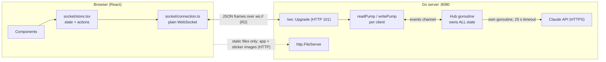

# ARCHITECTURE

Read this to be able to explain the server out loud. Each section ends with the question an instructor is likely to ask and where in the code the answer is.

## 1. The big picture

- **One TCP connection per browser tab.** It starts as an HTTP request, the server answers `101 Switching Protocols`, and from then on the same TCP connection carries WebSocket frames both ways.
- **Chat never uses HTTP** (R2). HTTP serves `index.html`, JS/CSS and sticker SVGs only.
- **The server is the authority.** Who may see a DM or group message is decided in `hub.go`, never in the UI.

## 2. What happens from connect to disconnect

1. Browser: `new WebSocket("ws://host:8080/ws")` (`client-web/src/socket/connection.ts`).
2. Server: `Hub.ServeWS` upgrades the request (`gorilla Upgrader.Upgrade`), creates a `Client`, starts `writePump` in a goroutine and runs `readPump` in the request goroutine (`server/hub.go`, `server/client.go`).
3. `readPump` parses each text frame into an `Envelope` and posts it to the hub as an `inbound` event.
4. The hub goroutine (`Hub.Run` → `handle`) is the only code that reads or writes shared maps. It never writes to a socket itself: it calls `enqueue`, which puts bytes into the client's buffered channel.
5. `writePump` is the only writer of that connection and sends queued frames (plus a ping every 25 s).
6. When the connection breaks, `ReadMessage` returns an error, `readPump` posts `leave`, and `onLeave` frees the name, removes the user from groups, deletes empty groups and broadcasts new `user_list` / `group_list`.

**Explain-back:** *Walk me through a browser connecting until it disconnects.* → steps above; code: `ServeWS`, `readPump`, `onRegister`, `onLeave`.

## 3. Concurrency: why there is no mutex in the server

- Shared state (`byKey`, `groups`, `invites`, `unread`) is touched **only** by the goroutine running `Hub.Run`. Everyone else sends it events through `h.events`.
- So "is this name free? then take it" cannot interleave with another registration. Two simultaneous registrations are processed one after the other; the second sees the first. (`TestSimultaneousRegistrationOnlyOneWins` runs 10 at once.)
- gorilla allows one concurrent writer per connection → exactly one writer goroutine (`writePump`), fed by a channel.
- A slow client must not freeze others: `enqueue` never blocks. If the 64-frame buffer is full the client is disconnected (`Hub.send` → `kill`).
- `Client.send` is never closed (closing a channel that another goroutine might still send on panics); `Client.done` signals shutdown instead.
- The LLM call (seconds) runs in its own goroutine and re-enters the hub as a `summaryDone` event, so chat keeps flowing meanwhile (`TestSlowSummaryDoesNotBlockChat`).

**Explain-back:** *How does the server guarantee unique names with simultaneous registrations?* → `onRegister` checks and sets `h.byKey` inside the single hub goroutine.
**Explain-back:** *Why does each client need its own write loop?* → one writer per conn + a slow reader must not block the hub.

## 4. Privacy (R7, R10, R11) lives in the server

| Rule | Where | How |
|---|---|---|
| DM only for sender and receiver | `onDM` | exactly two `deliver` calls: sender and the one `byKey[to]` |
| Sender cannot be spoofed | `onDM`, `onGroupMsg` | `From` is `c.name` from the connection; any `from` the client sends is ignored |
| Group messages only for members | `onGroupMsg` | `g.has(c.key)` else `not_member`; fan-out loops over `g.Members` only |
| Nobody is auto-added | `onJoinGroup`, `onCreateGroup` | members change only on the user's own `join_group` / creator at creation |
| Scanning a QR never joins | `onInviteInfo` | read-only; joining is a separate `join_group` after the user presses Join |
| Summary only of messages you received | `onSummarize` | built from `h.unread[you][room]`, which `deliver` only filled with messages sent to you; room access checked first |

**Explain-back:** *Show me the exact line where a message is sent to only one person.* → the two `h.deliver(...)` calls at the end of `onDM`.
**Explain-back:** *How does the server decide who receives a group message?* → loop over `g.Members` in `onGroupMsg`.

## 5. Special features

- **Stickers (F3):** `kind:"sticker"` + `stickerId`. The server validates the id against `stickerPack` (`validContent`). Only the id crosses the socket; SVGs are static assets, so R2 holds. What travels: `{"type":"dm","payload":{"to":"bob","kind":"sticker","stickerId":"love"}}`.
- **QR invite (F2):** `create_invite` (members only) → 128-bit token → link `/?invite=<token>` → QR drawn in the browser (`features/groups/InviteQr.tsx`). Opening the link registers a name if needed, sends `invite_info`, and shows "Join group X?". Joining sends `join_group` with the token.
- **Notifications (F4):** the **server** only delivers the message and counts unread. The **browser** decides how to alert: in-app toast + sound + title badge always; OS notification (`Notification` API) only when the tab is hidden, permission was granted and the page is a secure context. Over `http://<LAN-IP>` the API is unavailable, so the fallback is what the demo shows. Options to get real notifications on a demo: use `localhost` on the presenter's machine, or serve HTTPS (cloud deploy, tunnel, or a local dev certificate).
- **AI summary (F1):** client sends `summarize_request` over the socket → hub builds lines from this user's unread messages of that room → goroutine calls Claude over HTTPS with a timeout → `summary_result` / `summary_error` returns over the same socket. Trace for the explain-back: *Browser →(WebSocket/TCP)→ Go server →(HTTPS/TCP, DNS to find the API host)→ Claude API, and back the same way.*

## 6. Protocols used (R1)

See README section 7 for the full table and the rejected alternatives (UDP, Socket.IO, polling, SSE, MQTT/gRPC).

## 7. Known limits (be honest about these in the demo)

- No message history: messages exist only in open tabs; closing the tab loses them.
- Unread counts and group membership vanish when a user disconnects.
- No authentication: a name is just whoever claimed it first while connected.
- Single server process, state in memory.
- `go test -race` was not run (no suitable C compiler on the first machine).
- The live Claude call was not exercised without an API key.
